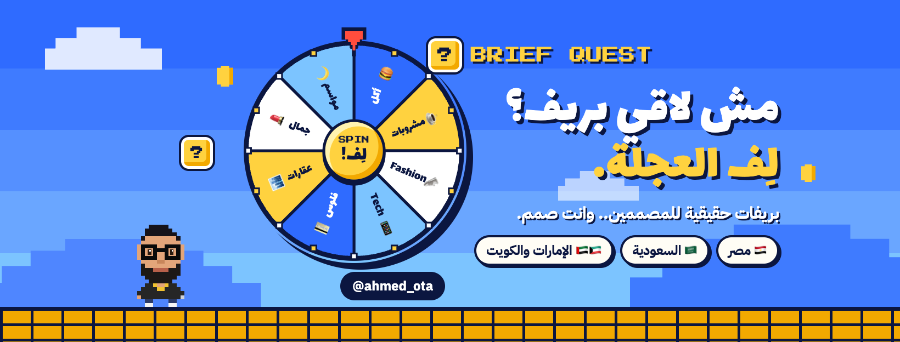

<h1 align="center">🎮 Brief Quest</h1>

  <b>No brief to work on? Spin the wheel.</b> 
  Real-world design briefs from Egypt, Saudi Arabia and the Gulf — written exactly like the ones clients send.

  <a href="https://github.com/ahmedotaota/brief-quest-download/releases/latest/download/BriefQuest-Mac.dmg"><b>⬇️ Download for macOS</b></a>
  &nbsp;·&nbsp;
  <a href="https://github.com/ahmedotaota/brief-quest-download/releases/latest/download/BriefQuest-Windows-Setup.exe"><b>⬇️ Download for Windows</b></a>

---

## What is it?

Brief Quest is a free practice app for designers who are stuck waiting for the "right" brief. Spin the wheel, get a complete brief, and start designing — no client needed.

- 🎡 **Spin the wheel** to get a brief from 8 categories: Food, Drinks, Fashion, Tech, Finance, Real Estate, Beauty, Seasonal.
- 🌍 **3 worlds:** Egypt, Saudi Arabia, and the UAE & Kuwait — each brief written in its local dialect and culture.
- 📋 **A complete brief:** Objective, Target Audience, Insight, Key Message, Tone of Voice, Mandatories, and Deliverables with exact sizes.
- ⭐ **3 difficulty levels** plus a bonus challenge on every brief.
- 🧠 **Pro Tips** on Layout, Hierarchy, Composition, Typography, Color, Social Media and AI in design.
- 🪙 **Earn coins** for every brief you finish, and share your work to get feedback.
- 🕹️ Retro pixel-art style, 8-bit music, and a little mascot to keep you company.

> The app interface is in Arabic.

## Installation

### 🍎 macOS (Apple Silicon & Intel)
1. Download **BriefQuest-Mac.dmg** and open it.
2. Drag **Brief Quest** into your **Applications** folder.
3. **First launch only:** right-click the app → **Open** → **Open**.
   macOS shows this prompt for apps distributed outside the App Store.

### 🪟 Windows
1. Download **BriefQuest-Windows-Setup.exe** and double-click it.
2. If Windows SmartScreen appears: **More info** → **Run anyway**.
3. The app installs automatically and adds a desktop shortcut.

## ⚠️ Official downloads only

The official Brief Quest builds are published **only on this page**. If you find the app anywhere else, don't download it.
You can verify your download against the SHA-256 checksums listed on each [release](https://github.com/ahmedotaota/brief-quest-download/releases).

## Connect

Made by **Ahmed Ota** — Art Director.

[Facebook](https://www.facebook.com/ahmedibrahem.ali) · [Instagram](https://www.instagram.com/ahmed_ota/) · [Behance](https://www.behance.net/ahmedota)

Finished a brief? Post your work, tag me, and use **#BriefQuest** — I'd love to see it.

---

© 2026 Ahmed Ota. All rights reserved. Free for personal use and practice — see <a href="LICENSE">LICENSE</a>. All brands inside the app are fictional and created for practice only.

